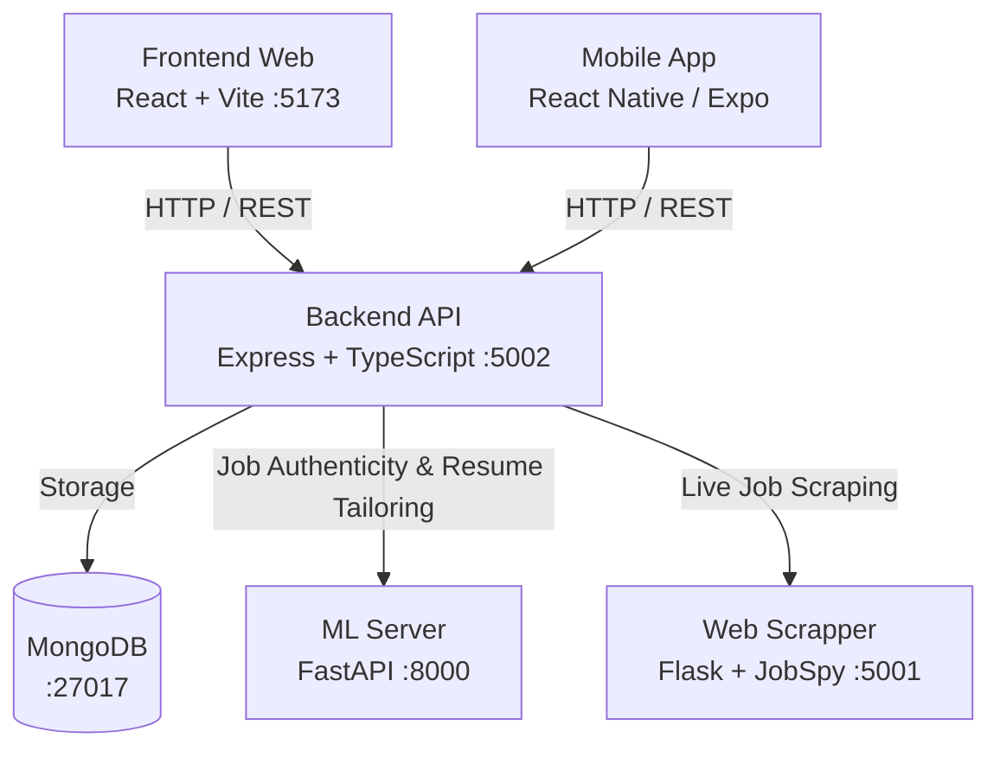

# 🚀 Swipe-Select — Developer Onboarding & Architecture Guide

Welcome to the **Swipe-Select** organization. This repository serves as the central documentation and onboarding hub for the complete Swipe-Select engineering ecosystem.

---

## 📋 Table of Contents
- [Architecture Overview](#-architecture-overview)
- [Quick Start Cheat Sheet](#-quick-start-cheat-sheet)
- [System Prerequisites](#-system-prerequisites)
- [Step-by-Step Repository Setup](#-step-by-step-repository-setup)
  - [1. Database (MongoDB)](#1-database-mongodb)
  - [2. Machine Learning Service (Swipe-Select-ML)](#2-machine-learning-service-swipe-select-ml)
  - [3. Job Scraper Service (Web-Scrapper)](#3-job-scraper-service-web-scrapper)
  - [4. Core API Backend (Swipe-Select-Backend)](#4-core-api-backend-swipe-select-backend)
  - [5. Web Application (Swipe-Select-Frontend-Web)](#5-web-application-swipe-select-frontend-web)
  - [6. Mobile Application (Swipe-Select-MobileApp)](#6-mobile-application-swipe-select-mobileapp)
- [Recommended Startup Sequence](#-recommended-startup-sequence)
- [Port Reference Map](#-port-reference-map)

---

## 🏗️ Architecture Overview



---

## ⚡ Quick Start Cheat Sheet

| Repository | Tech Stack | Port / URL | One-Time Dependency Setup | Start Command |
| :--- | :--- | :--- | :--- | :--- |
| **`Swipe-Select-Backend`** | Node.js, Express, TypeScript | `http://localhost:5002` | `npm install` | `npm run dev` |
| **`Swipe-Select-Frontend-Web`** | React 19, Vite, TypeScript | `http://localhost:5173` | `npm install` | `npm run dev` |
| **`Swipe-Select-MobileApp`** | React Native, Expo, NativeWind | Metro Bundler | `npm install` | `npm start` |
| **`Swipe-Select-ML`** | Python 3.10+, FastAPI, PyTorch | `http://localhost:8000` | Automated by `./run.sh`<br>*(or `python3 -m venv venv && ./venv/bin/pip install -r requirements.txt`)* | `./run.sh` |
| **`Web-Scrapper`** | Python 3.10+, Flask, JobSpy | `http://localhost:5001` | Automated by `./run_backend.sh`<br>*(or `python3 -m venv venv && ./venv/bin/pip install -r requirements.txt`)* | `./run_backend.sh` |

---

## 💻 System Prerequisites

Ensure you have the following installed on your local machine:
- **Node.js**: `v18.x` or `v20.x` (LTS recommended) & `npm`
- **Python**: `3.10+` (Python 3.11+ recommended) & `pip`
- **MongoDB**: Community Edition (`v6.0+`) running locally on port `27017`
- **Git** & **GitHub CLI** (`gh`)
- **Expo Go App** (optional, on your iOS/Android phone to test mobile builds)

---

## 📦 Step-by-Step Repository Setup

### 1. Database (MongoDB)
Ensure MongoDB is running locally:
```bash
# macOS (Homebrew)
brew services start mongodb-community

# Linux / Ubuntu
sudo systemctl start mongod

# Verify MongoDB is active on port 27017
mongosh --eval "db.adminCommand('ping')"
```

---

### 2. Machine Learning Service (`Swipe-Select-ML`)
Serves **ModernBERT** (Fake Job Classification) and **Qwen2.5-3B** (GGUF Resume Tailoring).

1. Navigate to the repo:
   ```bash
   cd Swipe-Select-ML
   ```
2. **Download Model Weights from Team Google Drive**:
   Place the two model files into their respective directories:
   - `models/fake_job_detection/model.safetensors` (~571 MB)
   - `models/resume_generation/Qwen2.5-3B-Instruct.Q4_K_M.gguf` (~1.8 GB)
3. **Verify Environment**:
   ```bash
   python3 scripts/verify_setup.py
   ```
4. **Start the Service**:
   ```bash
   ./run.sh
   ```
   *The launcher automatically initializes a virtual environment and installs dependencies if missing.*
   - Swagger Documentation: [http://localhost:8000/docs](http://localhost:8000/docs)
   - Health Check: [http://localhost:8000/health](http://localhost:8000/health)

---

### 3. Job Scraper Service (`Web-Scrapper`)
Provides live job fetching from LinkedIn, Indeed, and Rozee.pk.

1. Navigate to the repo:
   ```bash
   cd Web-Scrapper
   ```
2. **Start the Backend API**:
   ```bash
   ./run_backend.sh
   ```
   *Automatically initializes virtual environment and installs `requirements.txt` if needed.*
   - API Endpoint: `http://localhost:5001`
   - Health Check: `http://localhost:5001/api/health`

---

### 4. Core API Backend (`Swipe-Select-Backend`)
Main REST API handling authentication, job matching, user profiles, and microservice proxying.

1. Navigate to the repo:
   ```bash
   cd Swipe-Select-Backend
   ```
2. **Install Dependencies**:
   ```bash
   npm install
   ```
3. **Environment Configuration**:
   Verify or create `.env`:
   ```env
   PORT=5002
   NODE_ENV=development
   MONGO_URI=mongodb://127.0.0.1:27017/swipe-select
   JWT_SECRET=your_jwt_secret_here
   JWT_EXPIRES_IN=7d
   SCRAPER_API_URL=http://localhost:5001
   ML_SERVER_URL=http://localhost:8000
   ```
4. **Seed Initial Database (Optional)**:
   ```bash
   npm run seed
   ```
5. **Start Dev Server**:
   ```bash
   npm run dev
   ```
   - Running at: [http://localhost:5002](http://localhost:5002)

---

### 5. Web Application (`Swipe-Select-Frontend-Web`)
Client-side web application built with React 19 and Vite.

1. Navigate to the repo:
   ```bash
   cd Swipe-Select-Frontend-Web
   ```
2. **Install Dependencies**:
   ```bash
   npm install
   ```
3. **Start Development Server**:
   ```bash
   npm run dev
   ```
   - Running at: [http://localhost:5173](http://localhost:5173)

---

### 6. Mobile Application (`Swipe-Select-MobileApp`)
Cross-platform mobile application built with React Native and Expo.

1. Navigate to the repo:
   ```bash
   cd Swipe-Select-MobileApp
   ```
2. **Install Dependencies**:
   ```bash
   npm install
   ```
3. **Start Metro Bundler**:
   ```bash
   npm start
   ```
4. **Run on Desired Target**:
   - Press `i` to launch in iOS Simulator
   - Press `a` to launch in Android Emulator
   - Press `w` to run in web browser
   - Scan the terminal QR code with the **Expo Go** app on your physical device

---

## 🚦 Recommended Startup Sequence

For a complete local development session, open separate terminal windows and launch in this order:

1. **Terminal 1 (ML)**: `cd Swipe-Select-ML && ./run.sh`
2. **Terminal 2 (Scraper)**: `cd Web-Scrapper && ./run_backend.sh`
3. **Terminal 3 (Backend)**: `cd Swipe-Select-Backend && npm run dev`
4. **Terminal 4 (Frontend)**: `cd Swipe-Select-Frontend-Web && npm run dev`
5. **Terminal 5 (Mobile)**: `cd Swipe-Select-MobileApp && npm start`

---

## 🔌 Port Reference Map

| Port | Service | Description |
| :--- | :--- | :--- |
| **`27017`** | MongoDB | Local Database Engine |
| **`5001`** | Web-Scrapper | JobSpy Python Scraper API |
| **`5002`** | Swipe-Select-Backend | Core Express REST API |
| **`5173`** | Swipe-Select-Frontend-Web | React 19 Vite Web Application |
| **`8000`** | Swipe-Select-ML | FastAPI Machine Learning Microservice |
| **`8081`** | Swipe-Select-MobileApp | Expo Metro Bundler Default Port |
